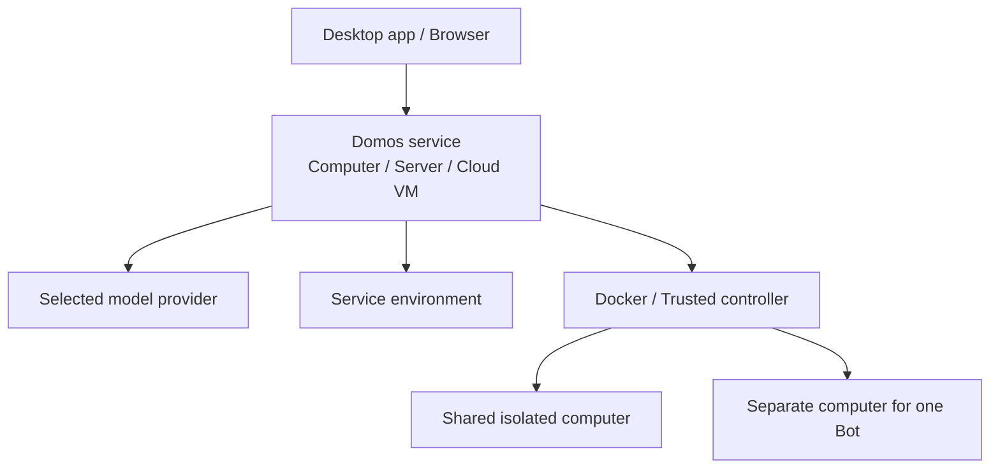

<div align="center">


# Domos

### Persistent AI companions and personal assistants.

**A self-hosted alternative to Grok Bot and Meta Muse.**

Give AI lasting memory, tools, and a place to work.<br>
Run Domos on your computer or server. Keep the service running, and your companions stay ready around the clock.

[](#-project-license)
[](package.json)
[](package.json)

**[Quick Start](#-quick-start)** &nbsp;·&nbsp; **[Why Domos?](#-why-domos)** &nbsp;·&nbsp; **[Features](#-key-features)** &nbsp;·&nbsp; **[Work Environments](#-work-environments)** &nbsp;·&nbsp; **[Self-Hosting](#-self-hosting--other-devices)** &nbsp;·&nbsp; **English** · [简体中文](README.zh-CN.md)

</div>

---

## 💡 Why Domos?

Keep a personal assistant that remembers your preferences. Or build a team with clear roles: research, code review, and file work, each with a companion of its own.

Domos gives these companions lasting memory, useful tools, and a steady place to work. Come back tomorrow and continue the conversation. You choose where they run, which models they use, and which work environments they can access.

- 🤖 **Companions with a role**: Give each Bot a name, instructions, a model, and skills. Save useful memories so it can carry context into future work.
- 🌐 **A home you choose**: Run the service on your computer, home server, or cloud VM. Return through the desktop app or a browser.
- 💻 **A place to do real work**: Run commands, edit files, and create results. Use the service environment, a shared Docker computer, or a separate one for each Bot.
- ⏰ **Hand off work and step away**: Start a task or schedule a briefing or file routine. Work can continue in the background while the service runs.
- 🔑 **Models you choose**: Connect supported providers such as OpenAI, Anthropic, Google Gemini, and DeepSeek. Pick a suitable model for each companion.

Grok Bot and Meta Muse offer persistent AI companions. Domos lets you host the service, choose models, and manage where data is stored.

---

## ✨ Key Features

| Capability | What you can do |
| :--- | :--- |
| 👥 **Companions and teams** | Create Bots with different roles. Manage their identities, models, chats, and skills. |
| 🧠 **Lasting memory** | Save useful information across conversations. Keep chats, memories, and skills across restarts. |
| 💻 **Commands and files** | Upload files, run commands, edit work files, and download results. |
| ⏰ **Scheduled tasks** | Run tasks once or on a repeating schedule. Review results and run records. |
| 📱 **Access from other devices** | Pair a device with a one-time code, connect through a browser, and revoke access when needed. |
| 🔑 **Your model accounts** | Sign in or enter a key in the app. Select a connected model. Model credentials are encrypted at rest. |

Computer tools currently support commands and files. They do not control a graphical desktop. Phones and tablets use the browser interface.

Users must review and enable scheduled tasks. Tasks run only while the Domos service runs. After a restart, missed repeats are combined into one run. A local service cannot keep working while its computer is asleep or shut down.

---

## 🚀 Quick Start

### Option A: Run the desktop app from source

Get the source code for this repository and open its project folder. Source builds need **Node.js 24+** and **pnpm 10.20.0**.

```sh
pnpm install --frozen-lockfile
pnpm desktop
```

The desktop app guides you through setup:

1. **Choose where Domos runs.** Use this computer or connect to an existing Domos.
2. **Connect a model and meet your first companion.** Sign in to a model account or enter a key. Then give your Bot a name and a role.
3. **Choose where the Bot works.** Confirm access to commands and files. Domos prepares and binds the selected environment.

On this computer, **Run directly** needs no Docker. **Run in Docker** needs an installed and running Linux Docker engine and Compose. The app checks the engine and prepares images after you confirm a Docker option. The first setup can include downloads and builds.

To connect to an existing Domos, use its address and a pairing code. A service with completed setup shows its existing Bots and chats. The next launch restores your saved connection.

The desktop app uses Electron. Windows has desktop tests and a packaging workflow. macOS and Linux have build configurations but still need platform validation. See [Development](#-project-structure--development) to build an installer.

### Option B: Run in a browser

Run these commands in the project folder:

```sh
pnpm install --frozen-lockfile
pnpm build
pnpm start
```

1. Open **http://127.0.0.1:4310**.
2. Enter the first administrator code from `data/owner-code`.
3. Connect a model, set up your Bot, and choose its work environment.

The default address is available only on this computer. See [Self-Hosting & Other Devices](#-self-hosting--other-devices) to connect another device.

---

## 🖥️ Work Environments

**Where Domos runs and where your Bot works are separate choices.** Set a work environment for each Bot.

| Work environment | Where the Bot works | Access |
| :--- | :--- | :--- |
| **Use the service environment** | On the computer or inside the container that runs Domos. | Uses the service account's system access and shares the service environment. |
| **Share an isolated computer** | In a Docker work container shared with other Bots. | Bots in the same container share system permissions and files. |
| **Use a separate isolated computer** | In a Docker work container reserved for this Bot. | Uses a separate work container and a persistent volume. |

For an existing service, these choices refer to the **service's computer**, not the device in front of you. The service needs an isolated-computer template before it can prepare shared or separate computers.

Docker work containers use a non-root user, a read-only root filesystem, and limits on CPU, memory, and process count. Network access can be disabled or restricted. See the [network requirements](deploy/README.md#网络). These controls reduce access and runtime risk.

Separate folders in one environment do not isolate Bots. Changing work environments does not copy files. Changing service modes does not move chats or work files.

---

## 🧠 How It Works

Domos separates the interface, service, and task execution. The desktop app and browsers connect to the same service. Each Bot uses its selected work environment.



1. **Interface**: Chat, upload files, view results, and manage Bots and tasks.
2. **Service**: Store chats and memories, connect models, and schedule background work.
3. **Work environment**: Run commands and process files in the service environment or a separate container.

Domos uses Pi and Pi Durable for model access and persistent Agent work.

**Chats and files are stored in the service you deploy.** Model credentials use AES-256-GCM encryption at rest. Chats, memories, and attachments are not encrypted at rest. When you use a cloud model, request context and required authentication data are sent to that provider.

---

## 🌐 Self-Hosting & Other Devices

Keep Domos on a computer or server that stays on. You can leave the client and return from another device to check progress.

### Run on a server

For native hosting, use the [browser setup](#option-b-run-in-a-browser) above. For Docker hosting, get the source on a Linux server and prepare a running Docker engine and Compose. Then run this command in the project folder:

```sh
sh deploy/install.sh
```

The script builds images, creates the initial configuration, and starts the service. It publishes to `127.0.0.1:4310` by default. When setup finishes, it prints the command to read the first administrator code.

### Connect other devices

1. Configure an **HTTPS address** that the other devices can reach. Pairing grants access; it does not open a network route.
2. As an administrator, open **Settings → General → Use on other devices** and create a one-time pairing code.
3. Enter the address in the desktop app on another computer, or open it in a phone or tablet browser. Then enter the pairing code.

You can revoke a device's access at any time. The service can keep working after you close a client. Its computer must stay on and awake.

### Data and backups

Desktop maintenance lets you create encrypted backups and restore data manually. It stops the managed service before backup. Server Compose deployments need a separate backup of their data volumes after writes stop.

See the [deployment guide](deploy/README.md) for HTTPS, work computer networks, backup scope, and recovery steps.

---

## 🛠️ Project Structure & Development

Domos uses TypeScript. The interface uses React 19 and Vite.

| Folder | Purpose |
| :--- | :--- |
| `apps/desktop` | Electron desktop app and local service setup. |
| `apps/web` | Chat, Bot settings, and onboarding. |
| `apps/api` | Authenticated service and file access. |
| `apps/controller` | Isolated computer lifecycle and transport. |
| `apps/cli` | Terminal chat and service management commands. |
| `packages/agent` | Persistent Agents, tools, memory, and routines. |
| `packages/hosting` | Pairing, credentials, service setup, and backups. |
| `packages/ui` | Shared controls, theme, and identity. |

### Development commands

```sh
pnpm lint
pnpm typecheck
pnpm test
pnpm exec playwright install chromium --only-shell
pnpm test:e2e
```

On Linux, add `--with-deps` to the browser install command if you also need to install system dependencies.

For web development, run `pnpm start` and `pnpm web` in separate terminals. Open the address shown by Vite. For terminal chat, run `pnpm chat`.

Build a desktop installer:

```sh
pnpm --filter @domos/desktop dist
```

Output goes to `apps/desktop/release`. Local builds are unsigned.

Tests use temporary data and test models. The standard suite needs no model keys. Real container tests require Docker and run separately. See the [deployment checks](deploy/README.md#验收).

---

## 🤝 Contributing

Help make Domos better. Use this repository's Issues to report problems or suggest features. Submit a Pull Request to improve tools, model access, documentation, or the user experience.

---

## 📄 Project License

**The project license is pending.** For third-party licenses and attribution, see the [deployment notices](deploy/NOTICE) and [Agent work module notices](third_party/agent-work/NOTICE.md).
