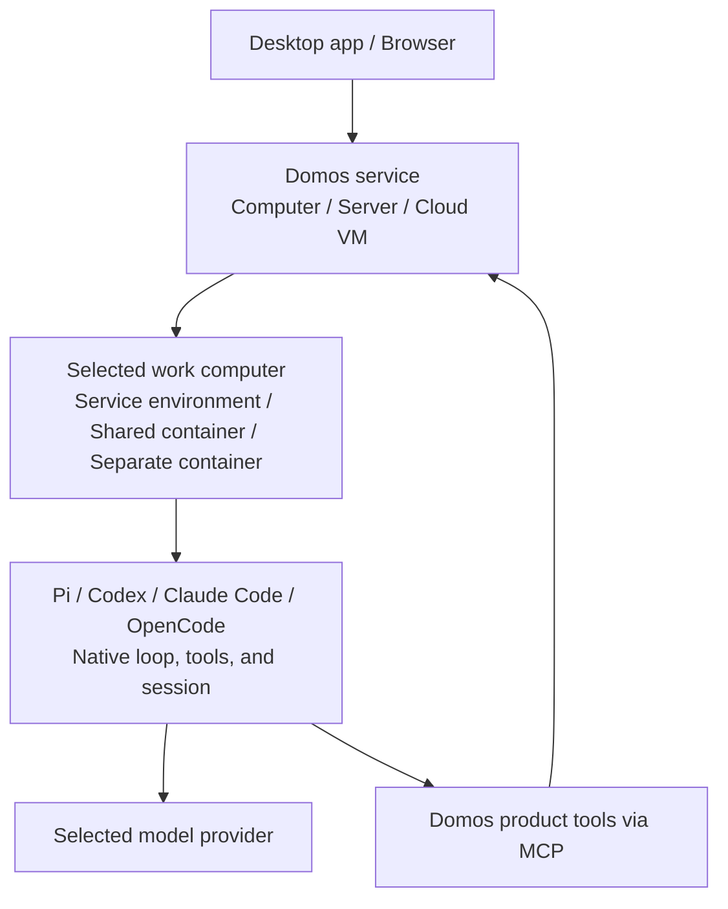

<div align="center">


# Domos

### Persistent AI companions and personal assistants.

**A self-hosted alternative to Grok Bot and Meta Muse.**

Give AI lasting memory, tools, and a place to work.<br>
Run Domos on your computer or server. Keep the service running, and your companions stay ready around the clock.

[](#-project-license)
[](package.json)
[](package.json)

**[Quick Start](#-quick-start)** &nbsp;·&nbsp; **[Why Domos?](#-why-domos)** &nbsp;·&nbsp; **[Features](#-key-features)** &nbsp;·&nbsp; **[Work Environments](#-work-environments)** &nbsp;·&nbsp; **[Self-Hosting](#-self-hosting--other-devices)** &nbsp;·&nbsp; **English** · [简体中文](README.zh-CN.md)

</div>

---

## 💡 Why Domos?

Keep a personal assistant that remembers your preferences. Or build a team with clear roles: research, code review, and file work, each with a companion of its own.

Domos gives these companions lasting memory, useful tools, and a steady place to work. Come back tomorrow and continue the conversation. You choose where they run, which models they use, and which work environments they can access.

- 🤖 **Companions with a role**: Give each Bot a name, instructions, an engine, and skills. Save useful memories so it can carry context into future work.
- 🌐 **A home you choose**: Run the service on your computer, home server, or cloud VM. Return through the desktop app or a browser.
- 💻 **A place to do real work**: Run commands, edit files, and create results. Use the service environment, a shared Docker computer, or a separate one for each Bot.
- ⏰ **Hand off work and step away**: Start a task or schedule a briefing or file routine. Work can continue in the background while the service runs.
- 🔑 **Models you choose**: Connect supported providers such as OpenAI, Anthropic, Google Gemini, and DeepSeek. Pick a suitable model for each companion.

Grok Bot and Meta Muse offer persistent AI companions. Domos lets you host the service, choose models, and manage where data is stored.

---

## ✨ Key Features

| Capability | What you can do |
| :--- | :--- |
| 👥 **Companions and teams** | Create Bots with different roles. Manage their identities, models, chats, and skills. |
| 🧠 **Lasting memory** | Save useful information across conversations. Keep chats, memories, and skills across restarts. |
| 💬 **Complete replies** | Receive each complete message as it is ready. Dots show when your Bot is still working. Files arrive when the task completes. Questions and approval requests appear at once. |
| 💻 **Commands and files** | Upload files, run commands, edit work files, and download results. |
| ⚙️ **Your choice of engine** | Use Pi, Codex, Claude Code, or OpenCode. Keep each engine's native tools and session. |
| ⏰ **Scheduled tasks** | Run tasks once or on a repeating schedule. Review results and run records. |
| 📱 **Access from other devices** | Pair a device with a one-time code, connect through a browser, and revoke access when needed. |
| 🔑 **Your accounts** | Connect model services for Pi. Use an engine's supported sign-in or API key option. Keys stored by the service are encrypted. |

Enable desktop tools in the Computer tab. The target window and Agent cursor use the Bot's color. Local and remote viewers share these effects. Phones and tablets use the browser interface.

Optional **Jev assistance** is available in the Computer tab. Save a TypeSafe or OpenRouter key, test the connection, then enable it for this Bot and work computer. Keys use the service's encrypted credential store. Selected interface text or screenshots go to that provider. Pi, Codex, Claude Code, and OpenCode share the same bounded `computer_assist` tool. It observes after each action and hands uncertain results back to the main model. The action limit is 12; the time limit is 45 seconds. Existing approval and takeover controls still apply. Switching providers disables assistance until you enable it again. Latency and cost depend on the task and provider.

Native effects need a logged-in graphical session on the work computer. Desktop builds and work images include the helper. For a source installation, run `pnpm --filter @domos/agent exec install-electron` on that computer. Linux native effects need X11. Viewer effects do not need a native overlay. Desktop tools still need a graphical session that can provide captures.

Users must review and enable scheduled tasks. Tasks run only while the Domos service runs. After a restart, missed repeats are combined into one run. A local service cannot keep working while its computer is asleep or shut down.

---

## 🚀 Quick Start

### Option A: Run the desktop app from source

Get the source code for this repository and open its project folder. Source builds need **Node.js 24+** and **pnpm 10.20.0**.

```sh
pnpm install --frozen-lockfile
pnpm desktop
```

The desktop app guides you through setup:

1. **Choose where Domos runs.** Use this computer or connect to an existing Domos.
2. **Choose where the Bot works.** Confirm access to commands and files. Domos prepares and binds the selected environment.
3. **Choose who handles tasks.** Select Pi, Codex, Claude Code, or OpenCode. Connect an account and check the connection. Then start chatting.

Domos prepares your first Bot. If its setup is ready, you go straight to chat. Pick a suggested task to fill the message box, then send it when you are ready. Dismiss the hints or send your first message to finish the introduction.

For each new Bot, choose a name and avatar, then select its work computer and engine. Add standing instructions in Bot settings when needed.

On this computer, **Run directly** needs no Docker. **Run in Docker** needs an installed and running Linux Docker engine and Compose. The app checks the engine and prepares images after you confirm a Docker option. The first setup can include downloads and builds.

To connect to an existing Domos, use its address and a pairing code. A service with completed setup shows its existing Bots and chats. The next launch restores your saved connection.

The desktop app uses Electron. Windows has desktop tests and a packaging workflow. macOS and Linux have build configurations but still need platform validation. See [Development](#-project-structure--development) to build an installer.

### Option B: Run in a browser

Run these commands in the project folder:

```sh
pnpm install --frozen-lockfile
pnpm build
pnpm start
```

1. Open **http://127.0.0.1:4310**.
2. Enter the first administrator code from `data/owner-code`.
3. Choose a work computer and connect an engine for the default Bot. If its setup is ready, you go straight to chat.

The default address is available only on this computer. See [Self-Hosting & Other Devices](#-self-hosting--other-devices) to connect another device.

---

## 🖥️ Work Environments

**Where Domos runs and where your Bot works are separate choices.** Set a work environment for each Bot.

| Work environment | Where the Bot works | Access |
| :--- | :--- | :--- |
| **Use the service environment** | On the computer or inside the container that runs Domos. | Uses the service account's system access and shares the service environment. |
| **Share an isolated computer** | In a Docker work container shared with other Bots. | Bots in the same container share system permissions and files. |
| **Use a separate isolated computer** | In a Docker work container reserved for this Bot. | Uses a separate work container and a persistent volume. |

For an existing service, these choices refer to the **service's computer**, not the device in front of you. The service needs an isolated-computer template before it can prepare shared or separate computers.

Docker work containers use a non-root user, a read-only root filesystem, and limits on CPU, memory, and process count. Network access can be disabled or restricted. See the [network requirements](deploy/README.md#网络). These controls reduce access and runtime risk.

Separate folders in one environment do not isolate Bots. Changing work environments does not copy files. Changing service modes does not move chats or work files.

---

## ⚙️ Choose an Engine

An engine runs your Bot's tasks. Its own tools read files, run commands, and manage its conversation. Domos adds memories, skills, scheduled tasks, progress messages, and downloadable results.

| Engine | Connection | Account setup in Domos |
| :--- | :--- | :--- |
| **Pi** | Bundled Coding Agent, native RPC | Connect model services, then choose a model for each Bot. Keep several services connected. |
| **Codex** | Native app-server | Sign in in your browser or enter an OpenAI API key. |
| **Claude Code** | Native CLI | Sign in with the official CLI, or enter an Anthropic API key. |
| **OpenCode** | Native ACP | Use an available model, or connect a provider with its supported sign-in or key option. |

**Engines run on the Bot's work computer.** For example, a Windows computer can run the Domos service in one container and Pi and Codex in a shared Linux work container. Each Bot keeps its own session. The second Windows computer connects to the same service to send tasks and view progress.

Pi comes with Domos. For other engines, use **Check connection** first. If needed, choose **Install on work computer**. Domos downloads an engine only after this action. Direct installations need Node.js 24+ and npm on the work computer. The supplied work image includes them.

Choose an engine in the Bot's settings. Switch while the Bot is idle. Chats stay in Domos. Each work computer, engine, and account context has its own native session. Model and mode changes keep compatible sessions. Switching back adds recent messages after that session's saved position. Handoffs have a size limit and use attachment references. Native sessions cannot be converted between engines.

Choose the account source in the Bot's connection settings. The default, **Domos managed**, keeps a separate account directory. **Work computer configuration** lets Codex, Claude Code, OpenCode, and Pi read the running user's native accounts and model settings. Manage these accounts in the original CLI. Pi uses the bundled runtime and keeps Bot sessions separate. Other engines use an installed program first. You can download a missing program.

The account must be available where the engine runs. A local service with a local work computer can reuse local settings. Remote computers, containers, and system services use their own running user's settings. Client logins do not move to a remote computer. Terminal-only environment variables must reach the process that starts Domos. Bots on one computer share the selected account files and system access.

Work computer configuration keeps custom environment variable names used by native providers and credential helpers. `DOMOS_*`, `SERVICE_*`, and `DATABASE_URL` are reserved for service configuration and are not passed to native engines. Managed accounts keep their separate environment.

---

## 🧠 How It Works

Domos separates the interface, service, and task execution. The desktop app and browsers connect to the same service. Each Bot uses its selected work environment.



1. **Interface**: Chat, upload files, view results, and manage Bots and tasks.
2. **Service**: Store chats and memories, manage access, and schedule background work.
3. **Work computer and engine**: Run the selected engine and its tools in the assigned environment.

Pi Durable stores outer requests, product tool results, and task records. Each engine owns its native session. After a restart, Domos checks a recorded Codex turn for a completed result. When it cannot confirm the result, it asks you to check the work. It does not resend an uncertain task automatically.

**Chats and published files are stored in the service you deploy.** Server account credentials use AES-256-GCM encryption at rest. Native engine account files and sessions stay on the work computer and use that CLI's storage format. These files, chats, memories, and attachments do not have whole-store encryption. When you use a cloud model, request context and required authentication data are sent to that provider.

---

## 🌐 Self-Hosting & Other Devices

Keep Domos on a computer or server that stays on. You can leave the client and return from another device to check progress.

### Run on a server

For native hosting, use the [browser setup](#option-b-run-in-a-browser) above. For Docker hosting, get the source on a Linux server and prepare a running Docker engine and Compose. Then run this command in the project folder:

```sh
sh deploy/install.sh
```

The script builds images, creates the initial configuration, and starts the service. It publishes to `127.0.0.1:4310` by default. When setup finishes, it prints the command to read the first administrator code.

### Connect other devices

1. Configure an **HTTPS address** that the other devices can reach. Pairing grants access; it does not open a network route.
2. As an administrator, open **Settings → General → Use on other devices** and create a one-time pairing code.
3. On another computer, choose **Connect to an existing Domos** and enter that address. On a phone or tablet, open the address in a browser. Then enter the pairing code.

You can revoke a device's access at any time. The service can keep working after you close a client. Its computer must stay on and awake.

### Data and backups

Desktop maintenance lets you create encrypted backups and restore data manually. It stops the managed service before backup. Server Compose deployments need a separate backup of their data volumes after writes stop.

See the [deployment guide](deploy/README.md) for HTTPS, work computer networks, backup scope, and recovery steps.

---

## 🛠️ Project Structure & Development

Domos uses TypeScript. The interface uses React 19 and Vite.

| Folder | Purpose |
| :--- | :--- |
| `apps/desktop` | Electron desktop app and local service setup. |
| `apps/web` | Chat, Bot settings, and onboarding. |
| `apps/api` | Authenticated service and file access. |
| `apps/controller` | Isolated computer lifecycle and transport. |
| `apps/cli` | Terminal chat and service management commands. |
| `packages/agent` | Engine adapters, product tools, memory, and scheduled tasks. |
| `packages/hosting` | Pairing, credentials, service setup, and backups. |
| `packages/ui` | Shared controls, theme, and identity. |

### Development commands

```sh
pnpm lint
pnpm typecheck
pnpm test
pnpm exec playwright install chromium --only-shell
pnpm test:e2e
```

On Linux, add `--with-deps` to the browser install command if you also need to install system dependencies.

For web development, run `pnpm start` and `pnpm web` in separate terminals. Open the address shown by Vite. For terminal chat, run `pnpm chat`.

Build a desktop installer:

```sh
pnpm --filter @domos/desktop dist
```

Output goes to `apps/desktop/release`. Local builds are unsigned.

Tests use temporary data and test models. The standard suite needs no model keys. Real container tests require Docker and run separately. See the [deployment checks](deploy/README.md#验收).

---

## 🤝 Contributing

Help make Domos better. Use this repository's Issues to report problems or suggest features. Submit a Pull Request to improve tools, model access, documentation, or the user experience.

---

## 📄 Project License

**The project license is pending.** For third-party licenses and attribution, see the [deployment notices](deploy/NOTICE) and [Agent work module notices](third_party/agent-work/NOTICE.md).
