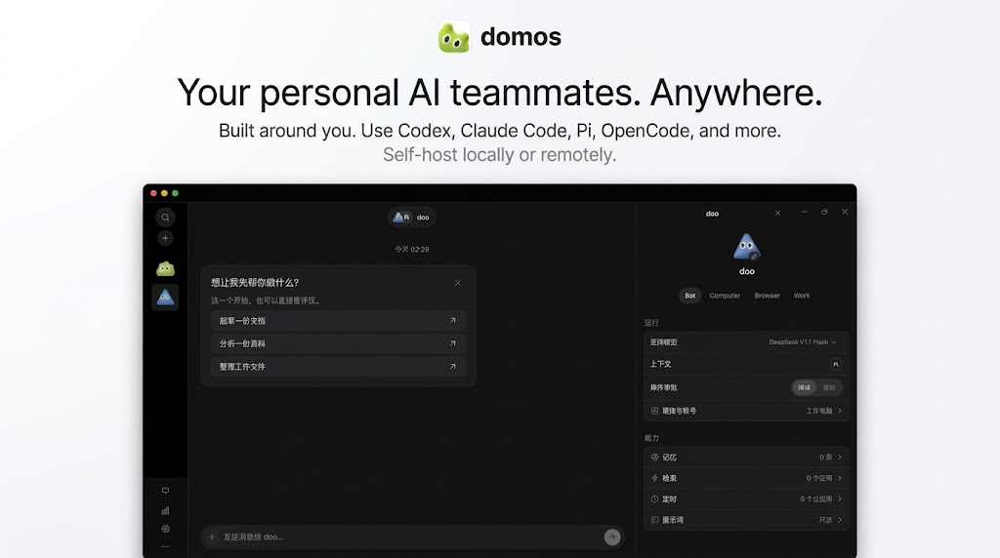

<div align="center">



**English** · [简体中文](README.zh-CN.md)

**[Quick Start](#quick-start)** · **[Features](#features)** · **[Engines](#choose-an-engine)** · **[Self-Hosting](#self-hosting-and-other-devices)** · **[Development](#development)**

</div>

**Domos is a self-hosted personal AI assistant project that gives you AI teammates for long-term collaboration.** It offers web and desktop apps with support for Codex, Claude Code, Pi, OpenCode, and other engines. Choose your models and work environments. Run it on a local computer or remote server.

Each teammate has its own identity, memory, and skills. Keep the conversation going, and let it use your computer, work with files, browse the web, or complete scheduled tasks.

## Quick Start

### Desktop app

To run from source, install **Git**, **Node.js 24+**, and **pnpm 10.20.0**. Then run:

```sh
git clone https://github.com/brandlll-lee/domos.git
cd domos
pnpm install --frozen-lockfile
pnpm desktop
```

The app guides you through setup:

1. **Choose where Domos runs.** Use this computer or connect to an existing service.
2. **Choose where your Bot works.** Select its work computer and confirm access to commands and files.
3. **Connect an engine.** Choose Pi, Codex, Claude Code, or OpenCode. Connect an account, check the connection, and start chatting.

Domos prepares your first Bot. Later, you can create more Bots with their own names, avatars, instructions, and work computers. Existing setups open directly in chat.

**Run directly** needs no Docker. A Docker work computer needs a running Linux Docker engine and Compose. The first setup can include downloads and builds.

Windows has desktop tests and a packaging workflow. macOS and Linux have build configurations but still need platform validation. To build an installer, see [Development](#development).

### Browser

In the same project folder, run:

```sh
pnpm install --frozen-lockfile
pnpm build
pnpm start
```

Open **http://127.0.0.1:4310**. Enter the first administrator code from `data/owner-code`, then choose a work computer and connect an engine.

The default address works only on this computer. See [Self-Hosting and Other Devices](#self-hosting-and-other-devices) for remote access.

## Features

- **Your choice of engine.** Use Pi, Codex, Claude Code, OpenCode, or a configured ACP engine. Keep their native tools and sessions. Choose from the models and thinking options each engine provides.
- **Memory and skills.** Give each Bot its own memories and skills. View native skills with their source and read-only status when the engine reports them. Import and export ZIP skill packages with `SKILL.md`, references, scripts, and assets. Preview changes and restore saved versions.
- **Computer and browser tools.** Let your Bot use apps, browse pages, run commands, and work with files on its assigned computer. Set permissions, approve operations, or take control when needed.
- **Chat and Work.** Answer questions, approve requests, and open takeover cards in chat. Preview images and download files. Work shows each run's current activity and elapsed time. Open its full record or stop the run.
- **Scheduled tasks.** Create, change, pause, resume, run, or delete schedules from chat after confirmation. Review run states and open their Work records. Execution time and time waiting for your input are tracked separately. You can set an execution limit.

Questions, answers, and request states stay in chat history. Each Bot keeps its own identity and conversation. Reopen a chat to continue your work.

## Choose an Engine

An engine runs your Bot's tasks. Domos adds memories, skills, schedules, chat, and computer access.

| Engine | How to connect |
| :--- | :--- |
| **Pi** | Bundled with Domos. Connect a model provider and choose a model. |
| **Codex** | Use its native sign-in or supported API key setup. |
| **Claude Code** | Use its native sign-in or supported API key setup. |
| **OpenCode** | Connect a provider through its native account and model settings. |
| **Custom ACP** | Configure the program and arguments. Available features depend on that program. |

**Engines run on the Bot's work computer.** Connection checks, sign-in, and tasks use the same program and OS user. A login on your client device does not sign in a remote work computer.

Pi comes with Domos. For other engines, check the connection first. Domos uses an installed program when available. If it is missing, choose **Install on work computer**. Direct installations need Node.js 24+ and npm on that computer. The supplied work image includes them.

Switch engines while the Bot is idle. Chats stay in Domos. Each engine keeps its own native session. Model access, thinking options, and account charges depend on the selected engine and provider.

## Self-Hosting and Other Devices

**Where Domos runs and where your Bot works are separate choices.** Your desktop app or browser connects to the service. Each Bot uses its assigned work computer.

| Work environment | Where the Bot works |
| :--- | :--- |
| **Service environment** | On the computer or in the container that runs Domos, with the service account's access. |
| **Shared isolated computer** | In a Docker work container shared with other Bots. They share its files and system access. |
| **Separate isolated computer** | In a Docker work container reserved for that Bot, with its own persistent volume. |

On a remote service, these choices refer to the service's computer. Separate folders do not isolate Bots. Changing work environments does not copy files.

### Run on a server

Use the [browser setup](#browser) for native hosting. For Docker hosting, get the source on a Linux server with Docker and Compose running. From the project folder, run:

```sh
sh deploy/install.sh
```

The script builds images, prepares configuration, and starts the service at `127.0.0.1:4310`. It prints the command to read the first administrator code.

### Connect another device

1. Configure an **HTTPS address** that the device can reach.
2. Open **Settings → General → Use on other devices** as an administrator. Create a one-time pairing code.
3. In the desktop app, choose **Connect to an existing Domos** and enter the address. On a phone or tablet, open the address in a browser. Enter the pairing code.

You can revoke access later. Pairing grants access; it does not create a network route.

### Data and requirements

- Chats, memories, and published files stay in the service you deploy. Native engine accounts and sessions stay on the work computer. Cloud models receive the context needed for their requests.
- Service-stored credentials use encryption at rest. Chat history, memories, attachments, and native session files do not have whole-store encryption.
- Desktop tools need a logged-in graphical session that can provide captures. Linux native cursor effects need X11.
- Scheduled tasks run while the service is on and awake. Closing a client does not stop the service. After a restart, missed repeats are combined into one run.
- Desktop maintenance supports encrypted backups and manual restore. Docker server deployments need a separate backup of their data volumes after writes stop.

See the [deployment guide](deploy/README.md) for networking, HTTPS, work computers, and backups.

## Development

[](package.json)
[](package.json)

Domos uses TypeScript, React 19, Vite, and Electron. See [AGENTS.md](AGENTS.md) for module ownership and the development workflow.

<details>
<summary>Development and test commands</summary>

For web development, run `pnpm start` and `pnpm web` in separate terminals. Open the address shown by Vite. Use `pnpm chat` for terminal chat.

```sh
pnpm lint
pnpm typecheck
pnpm test
pnpm exec playwright install chromium --only-shell
pnpm test:e2e
```

On Linux, add `--with-deps` to the browser install command if system dependencies are needed. Standard tests use temporary data and test models. They need no model keys. Real container tests need Docker and run separately.

Build a desktop installer:

```sh
pnpm --filter @domos/desktop dist
```

Output goes to `apps/desktop/release`. Local builds are unsigned.

</details>

- [Deployment and checks](deploy/README.md)
- [Native engines and context](docs/harness-context.md)
- [Browser control](docs/browser-use.md)
- [Memory, skills, and routines](docs/decisions/0001-bot-work.md)
- [Computer Use evaluations](docs/computer-evals.md)

## Contributing

Report problems and suggest features through [Issues](https://github.com/brandlll-lee/domos/issues). Pull requests for code, documentation, and the user experience are welcome. If Domos is useful to you, a star helps others find it.

## License

The project license is pending.
