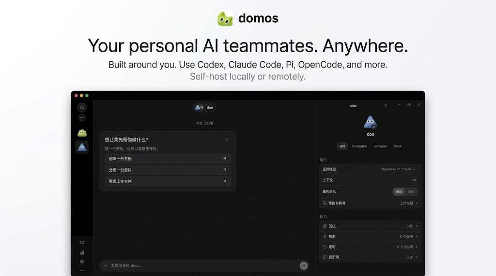

<div align="center">



[English](README.md) · **简体中文**

**[快速开始](#快速开始)** · **[核心功能](#核心功能)** · **[选择引擎](#选择引擎)** · **[自托管](#自托管与多端互联)** · **[本地开发](#本地开发)**

</div>

**Domos 是一个可自托管的个人 AI 助手项目，让你拥有可长期协作的 AI 队友。**它提供网页版和桌面应用，支持 Codex、Claude Code、Pi、OpenCode 等引擎。你可以选择自己的模型和工作环境，在本地电脑或远程服务器上运行。

每个队友都有自己的身份、记忆和技能。你可以与它持续交流，让它操作电脑、处理文件、浏览网页，或按计划完成工作。

## 快速开始

### 桌面应用

从源码运行需要安装 **Git**、**Node.js 24+** 和 **pnpm 10.20.0**，然后执行：

```sh
git clone https://github.com/brandlll-lee/domos.git
cd domos
pnpm install --frozen-lockfile
pnpm desktop
```

应用会带你完成设置：

1. **选择在哪里运行 Domos。** 使用这台电脑，或连接已有服务。
2. **选择 Bot 在哪里工作。** 选择工作电脑，确认命令与文件权限。
3. **连接任务引擎。** 选择 Pi、Codex、Claude Code 或 OpenCode，连接账号并检查连接，然后开始聊天。

Domos 会准备好第一个 Bot。以后可以创建更多 Bot，分别设置名字、头像、指令和工作电脑。已有配置可用时，直接进入聊天。

**直接运行**无需 Docker。Docker 工作电脑需要已启动的 Linux Docker 引擎与 Compose。首次准备可能需要下载和构建。

Windows 已有桌面测试与打包流程。macOS 和 Linux 已有打包配置，仍需分别验收。构建安装包见[本地开发](#本地开发)。

### 浏览器

在同一项目目录执行：

```sh
pnpm install --frozen-lockfile
pnpm build
pnpm start
```

打开 **http://127.0.0.1:4310**，输入 `data/owner-code` 中的首次管理员码，再选择工作电脑并连接引擎。

默认地址仅供本机访问。远程访问见[自托管与多端互联](#自托管与多端互联)。

## 核心功能

- **自由选择引擎。** 使用 Pi、Codex、Claude Code、OpenCode 或配置的 ACP 引擎。保留原生工具与会话，选择各引擎提供的模型和思考档位。
- **记忆与技能。** 为每个 Bot 保存自己的记忆和技能。引擎提供原生技能目录时，可查看来源与只读状态。导入、导出包含 `SKILL.md`、参考资料、脚本和素材的 ZIP 技能包。保存前预览差异，也能恢复历史版本。
- **电脑与浏览器工具。** 让 Bot 在指定的工作电脑上使用应用、浏览网页、运行命令和处理文件。你可以设置权限、批准操作，或在需要时接管控制。
- **聊天与 Work。** 在聊天中回答问题、处理审批和打开接管卡片。预览图片，下载文件。Work 显示每轮任务的当前活动与耗时，可打开完整记录或停止执行。
- **定时任务。** 在聊天中创建、修改、暂停、恢复、立即执行或删除计划，确认后生效。查看运行状态和对应的 Work 记录。执行时间与等待你操作的时间分别统计，也可设置执行期限。

问题、回答和请求状态会保留在聊天记录中。每个 Bot 有自己的身份和对话，再次打开即可继续工作。

## 选择引擎

引擎负责执行 Bot 的任务。Domos 提供记忆、技能、定时、聊天和电脑访问能力。

| 引擎 | 如何连接 |
| :--- | :--- |
| **Pi** | 随 Domos 提供。连接模型服务，再选择模型。 |
| **Codex** | 使用原生登录或受支持的 API 密钥配置。 |
| **Claude Code** | 使用原生登录或受支持的 API 密钥配置。 |
| **OpenCode** | 通过原生账号与模型设置连接提供方。 |
| **自定义 ACP** | 配置程序与参数，可用能力取决于该程序。 |

**引擎运行在 Bot 的工作电脑上。**检查连接、登录和执行任务使用同一程序与系统用户。客户端的登录不会自动传到远程工作电脑。

Pi 随 Domos 提供。其他引擎先检查连接，已有程序时优先复用。缺少时，再选择**在工作电脑安装**。直接安装需要该电脑已有 Node.js 24+ 和 npm，项目提供的工作镜像已包含它们。

Bot 空闲时可切换引擎。聊天记录保留在 Domos，各引擎保持自己的原生会话。可用模型、思考档位和账号费用取决于所选引擎及模型提供方。

## 自托管与多端互联

**Domos 在哪里运行，与 Bot 在哪里工作，是两个选择。**桌面应用或浏览器连接服务，每个 Bot 使用指定的工作电脑。

| 工作环境 | Bot 在哪里工作 |
| :--- | :--- |
| **服务所在环境** | 运行 Domos 的电脑或容器中，使用服务账户的访问权限。 |
| **共用隔离电脑** | 多个 Bot 共用的 Docker 工作容器，共享其中的文件与系统权限。 |
| **独立隔离电脑** | 此 Bot 专用的 Docker 工作容器，使用独立的持久卷。 |

连接远程服务时，这些选项指服务所在电脑。同一环境内的不同文件夹不构成隔离，更换工作环境也不会自动复制文件。

### 在服务器上运行

原生运行可使用上面的[浏览器方式](#浏览器)。Docker 部署需要在 Linux 服务器获取源码，并准备已运行的 Docker 引擎与 Compose。在项目目录执行：

```sh
sh deploy/install.sh
```

脚本会构建镜像、准备配置，并在 `127.0.0.1:4310` 启动服务。首次管理员码的读取命令会在完成后显示。

### 连接其他设备

1. 配置其他设备可访问的 **HTTPS 地址**。
2. 管理员打开**设置 → 通用 → 在其他设备上使用**，生成一次性配对码。
3. 桌面应用选择**连接已有 Domos**并填写地址。手机或平板通过浏览器打开该地址，再输入配对码。

以后可以撤销设备访问权限。配对码用于授权，不会自动建立网络通路。

### 数据与运行条件

- 聊天、记忆和已发布文件保存在你部署的服务中。原生引擎的账号与会话保存在工作电脑上。使用云模型时，所需上下文会发送给模型提供方。
- 服务保存的凭据经过加密。聊天、记忆、附件和原生会话文件没有整体加密。
- 桌面工具需要已登录、可捕获画面的图形桌面。Linux 原生光标效果需要 X11。
- 定时任务需要服务保持运行，电脑不能休眠。关闭客户端不会停止服务。重启后，错过的重复计划会合并补跑一次。
- 桌面维护入口支持加密备份和手动恢复。Docker 服务器部署需要停止写入后，单独备份数据卷。

网络、HTTPS、工作电脑与备份说明见[部署指南](deploy/README.md)。

## 本地开发

[](package.json)
[](package.json)

Domos 使用 TypeScript、React 19、Vite 和 Electron。模块职责与开发流程见 [AGENTS.md](AGENTS.md)。

<details>
<summary>开发与测试命令</summary>

开发网页时，在两个终端分别运行 `pnpm start` 和 `pnpm web`，再打开 Vite 输出的地址。终端聊天使用 `pnpm chat`。

```sh
pnpm lint
pnpm typecheck
pnpm test
pnpm exec playwright install chromium --only-shell
pnpm test:e2e
```

Linux 上首次安装测试浏览器时，如需系统依赖，可添加 `--with-deps`。常规测试使用临时数据和测试模型，无需模型密钥。真实容器测试需要 Docker，单独执行。

构建桌面安装包：

```sh
pnpm --filter @domos/desktop dist
```

产物位于 `apps/desktop/release`。本地构建尚未签名。

</details>

- [部署与验收](deploy/README.md)
- [原生引擎与上下文](docs/harness-context.md)
- [浏览器控制](docs/browser-use.md)
- [记忆、技能与定时任务](docs/decisions/0001-bot-work.md)
- [电脑操作评测](docs/computer-evals.md)

## 贡献与社区

通过 [Issues](https://github.com/brandlll-lee/domos/issues) 反馈问题、提出建议。欢迎提交代码、文档和体验改进。如果 Domos 对你有帮助，也欢迎点一颗 Star，让更多人发现它。

## 项目许可

项目许可证待定。
