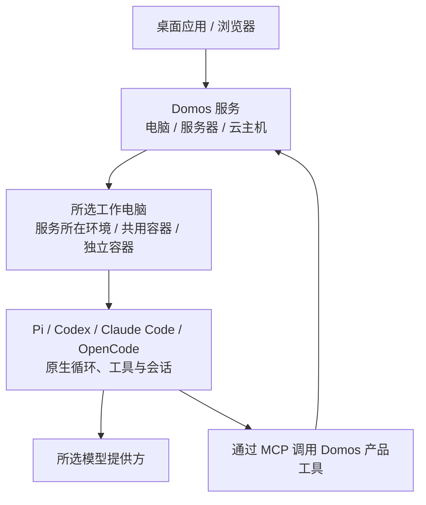

<div align="center">


# Domos

### 常驻身边的 AI 伙伴与专属助手。

**Grok Bot / Meta Muse 的自托管替代方案。**

为 AI 赋予持久记忆、工具与自己的工作空间。<br>
让它住在你的电脑或服务器上。只要服务保持运行，它就能全天候待命。

[](#-项目许可)
[](package.json)
[](package.json)

**[快速开始](#-快速开始)** &nbsp;·&nbsp; **[为什么选择 Domos](#-为什么选择-domos)** &nbsp;·&nbsp; **[核心特性](#-核心特性)** &nbsp;·&nbsp; **[工作环境](#-bot-的工作环境)** &nbsp;·&nbsp; **[自托管](#-自托管与多端互联)** &nbsp;·&nbsp; [English](README.md) · **简体中文**

</div>

---

## 💡 为什么选择 Domos？

你可以有一个记得你习惯的日常助手，也可以按职责组建自己的 AI 团队：整理资料、检查代码、处理文件，各有分工。

Domos 让这些伙伴拥有持续的记忆、可用的工具和固定的工作空间。今天交代的事，明天回来还能接着聊。你选择它们在哪里运行、使用什么模型，以及可以访问哪些工作环境。

- 🤖 **常驻身边，各司其职**：为每个 Bot 设置名字、职责、引擎和技能。保存有用的记忆，让它带着上下文继续工作。
- 🌐 **住在你选择的地方**：在个人电脑、家庭服务器或云主机上运行。通过桌面应用或浏览器，随时回来找它。
- 💻 **有自己的工作空间**：执行命令、读写文件、生成成果。可以使用服务所在环境，也可以选择共用或独立的 Docker 工作电脑。
- ⏰ **交代好任务，放心离开**：让它处理当前任务，或按计划准备晨报、整理文件。服务保持运行时，工作可以在后台继续。
- 🔑 **模型由你选择**：连接 OpenAI、Anthropic、Google Gemini、DeepSeek 等受支持的提供方，为不同伙伴选择合适的模型。

Grok Bot 和 Meta Muse 提供了常驻 AI 伙伴的产品体验。Domos 让你自行部署服务、选择模型并管理数据保存位置。

---

## ✨ 核心特性

| 能力 | 你可以做什么 |
| :--- | :--- |
| 👥 **AI 伙伴与团队** | 创建多个不同职责的 Bot，分别管理身份、模型、对话和技能。 |
| 🧠 **持久记忆** | 保存有用的信息，跨会话使用。聊天、记忆和技能在重启后保留。 |
| 💬 **完整交付** | 每条消息说完后立即收到，继续工作时显示三点动画。文件在任务完成后交付。需要你回答或授权时立即提示。 |
| 💻 **命令与文件** | 上传文件、运行命令、修改工作文件，并下载处理结果。 |
| ⚙️ **自由选择引擎** | 使用 Pi、Codex、Claude Code 或 OpenCode，保留各自的原生工具与会话。 |
| ⏰ **定时任务** | 按一次性时间或重复计划执行任务，查看结果与运行记录。 |
| 📱 **多设备访问** | 用一次性配对码授权其他设备，通过浏览器访问，随时撤销权限。 |
| 🔑 **自带账号** | 为 Pi 连接模型服务。其他引擎按支持的方式登录或填写 API 密钥。服务保存的密钥经过加密。 |

在 Computer 标签中启用桌面工具。目标窗口描边和 Agent 鼠标跟随 Bot 主题色。本地和远程观看端复用这些效果。手机和平板通过浏览器访问。

原生效果需要工作电脑已登录图形桌面。桌面构建和工作镜像包含辅助程序。源码安装请在工作电脑执行 `pnpm --filter @domos/agent exec install-electron`。Linux 原生效果需要 X11。观看端效果不依赖原生覆盖层。电脑工具仍需要可捕获画面的图形会话。

定时任务需要用户确认启用。任务仅在 Domos 服务运行时执行；服务重启后，错过的重复计划会合并补跑一次。本机休眠或关机期间，服务无法继续工作。

---

## 🚀 快速开始

### 方式 A：从源码启动桌面端

先获取本仓库源码，进入项目目录。源码运行需要 **Node.js 24+** 和 **pnpm 10.20.0**。

```sh
pnpm install --frozen-lockfile
pnpm desktop
```

桌面应用会带你完成设置：

1. **选择在哪里运行。** 使用这台电脑，或连接已有 Domos。
2. **选择 Bot 在哪里工作。** 确认命令与文件权限，Domos 会准备并绑定所选环境。
3. **选择由谁处理任务。** 选择 Pi、Codex、Claude Code 或 OpenCode，连接账号并检查连接，然后开始聊天。

Domos 会准备好第一个 Bot。已有配置可用时，直接进入聊天。点击入门任务会先填入输入框，由你确认发送。关闭提示或发送第一条消息后，提示就会结束。

以后新建 Bot，只需先取名、选头像，再为它选择工作电脑和引擎。长期指令可以在 Bot 设置中填写。

选择这台电脑后，可以**直接运行**，无需 Docker；也可以**在 Docker 中运行**，此方式需要已安装并启动的 Linux Docker 引擎与 Compose。确认 Docker 选项后，应用才会检查引擎并准备镜像。首次准备可能需要下载和构建。

连接已有 Domos 时，使用该服务的地址和配对码。已完成设置的服务会直接显示原有 Bot 和聊天记录。再次打开会恢复上次的连接。

桌面应用使用 Electron。Windows 已有桌面测试与打包流程；macOS 和 Linux 已提供打包配置，仍需分别验收。构建安装包见[本地开发](#-项目结构与本地开发)。

### 方式 B：在浏览器中使用

在项目目录执行：

```sh
pnpm install --frozen-lockfile
pnpm build
pnpm start
```

1. 打开 **http://127.0.0.1:4310**。
2. 输入 `data/owner-code` 中的首次管理员码。
3. 为默认 Bot 选择工作电脑，再连接它的引擎。已有配置可用时会直接进入聊天。

默认地址仅供本机访问。连接其他设备见[自托管与多端互联](#-自托管与多端互联)。

---

## 🖥️ Bot 的工作环境

**Domos 在哪里运行，与 Bot 在哪里干活，是两个选择。**你可以为每个 Bot 分别设置工作环境。

| 工作环境 | Bot 实际在哪里工作 | 访问范围 |
| :--- | :--- | :--- |
| **使用服务所在环境** | 运行 Domos 的电脑或服务容器中 | 使用服务账户的系统权限，与服务共享环境。 |
| **共用一台隔离电脑** | 多个 Bot 共用的 Docker 工作容器 | 同一容器中的 Bot 共享系统权限和文件。 |
| **单独一台隔离电脑** | 此 Bot 专用的 Docker 工作容器 | 使用独立的工作容器与持久卷。 |

连接已有服务时，这里的电脑指**服务所在电脑**，不是你手边的设备。服务配置了隔离电脑模板后，才可准备共用或独立电脑。

Docker 工作容器以非 root 用户运行，使用只读根目录，并限制 CPU、内存和进程数。网络可配置为关闭或受限访问，具体条件见[部署说明](deploy/README.md#网络)。这些措施用于减少访问范围与运行风险。

同一环境内的不同文件夹不构成隔离。更换工作环境不会自动复制文件。更换服务运行方式也不会自动迁移聊天或工作文件。

---

## ⚙️ 选择任务引擎

引擎负责让 Bot 完成任务。它用自己的工具读写文件、执行命令，并管理会话。Domos 为它补上记忆、技能、定时任务、进度消息和成果下载。

| 引擎 | 接入方式 | 在 Domos 中连接账号 |
| :--- | :--- | :--- |
| **Pi** | 内置 Coding Agent，使用原生 RPC | 可同时连接多个模型服务，再为每个 Bot 选择模型。 |
| **Codex** | 原生 app-server | 在浏览器中登录，或填写 OpenAI API 密钥。 |
| **Claude Code** | 原生 CLI | 通过官方程序登录，或填写 Anthropic API 密钥。 |
| **OpenCode** | 原生 ACP | 选择可用模型，或按服务商支持的方式登录、填写密钥。 |

**引擎运行在 Bot 所选的工作电脑中。**例如，一台 Windows 用一个容器运行 Domos 服务，另一个 Linux 工作容器供 Pi 和 Codex 共用。两个 Bot 各有自己的会话。第二台 Windows 连接同一个服务，就能发送任务、查看进度。

Pi 随 Domos 提供。其他引擎先点“检查连接”；尚未安装时，再点“在工作电脑安装”。确认安装后才下载。直接使用电脑安装时，需要该电脑已有 Node.js 24+ 和 npm。项目提供的工作镜像已包含它们。

在 Bot 设置中选择引擎。更换前先停止工作。聊天记录保留，新引擎会带上近期对话，开始自己的原生会话。不同引擎的原生会话不能直接互换。

在 Bot 的“连接与账号”中选择账号来源。默认“Domos 管理”保留独立的账号目录。选择“工作电脑已有配置”后，Codex、Claude Code、OpenCode 和 Pi 读取该电脑运行用户的原生账号与模型配置。原生账号在原 CLI 中登录、配置和退出。Pi 继续使用内置运行库，Bot 会话保持独立。其他引擎优先使用已有程序，缺少时可下载。

账号必须在引擎实际运行的电脑上生效。本机服务使用本机工作电脑时，可以复用本机配置。远端电脑、容器和系统服务使用各自运行用户的配置。客户端的登录不会自动传到远端。仅在终端中设置的环境变量，需要传给启动 Domos 的进程。同一电脑上的 Bot 共用所选来源的账号文件和系统权限。

---

## 🧠 它是如何工作的？

Domos 将界面、服务与任务执行分开。桌面应用和浏览器连接同一套服务，Bot 再使用所选工作环境处理任务。



1. **界面**：聊天、上传文件、查看成果，管理 Bot 与任务。
2. **服务**：保存聊天和记忆，管理访问权限，调度后台任务。
3. **工作电脑与引擎**：在所选环境中运行引擎，并使用它的工具处理任务。

Pi Durable 保存外层请求、产品工具结果与任务记录。各引擎保存自己的原生会话。重启后，Domos 会核对已记录的 Codex 轮次，补回已完成的结果。无法确认时，会提示你检查工作结果，不会自动重发任务。

**聊天和已发布文件保存在你部署的服务中。**服务端账号凭据使用 AES-256-GCM 加密保存。引擎的原生账号文件与会话保存在工作电脑中，使用各 CLI 的存储格式。这些文件、聊天、记忆和附件没有整体加密。使用云模型时，请求上下文及必要的鉴权信息会发送给所选提供方。

---

## 🌐 自托管与多端互联

让 Domos 住在一台持续运行的电脑或服务器上，你就可以离开客户端，再从其他设备回来查看进度。

### 在服务器上运行

原生运行可使用上面的[浏览器方式](#方式-b在浏览器中使用)。使用 Docker 部署时，先在 Linux 服务器获取源码，并准备已运行的 Docker 引擎与 Compose，再从项目目录执行：

```sh
sh deploy/install.sh
```

脚本会构建镜像、生成初始配置并启动服务。默认发布到 `127.0.0.1:4310`。首次管理员码的读取命令会在安装完成后显示。

### 连接其他设备

1. 为服务配置其他设备可访问的 **HTTPS 地址**。配对码只负责授权，不会自动开放网络。
2. 在管理员界面打开**设置 → 通用 → 在其他设备上使用**，生成一次性配对码。
3. 另一台电脑选择“连接已有 Domos”，填写该地址。手机、平板则用浏览器打开该地址，再输入配对码。

你可以随时撤销设备的访问权限。持续运行的服务可以在客户端关闭后继续工作；服务所在电脑仍需保持开机，且不能休眠。

### 数据与备份

桌面维护入口支持手动创建加密备份和恢复数据。备份前会停止托管服务。服务器 Compose 部署需要单独停止写入并备份数据卷。

HTTPS、工作电脑网络、备份范围与恢复步骤见[部署指南](deploy/README.md)。

---

## 🛠️ 项目结构与本地开发

Domos 使用 TypeScript，界面基于 React 19 与 Vite。

| 目录 | 职责 |
| :--- | :--- |
| `apps/desktop` | Electron 桌面应用与本机服务启动。 |
| `apps/web` | 聊天、Bot 设置与上手引导。 |
| `apps/api` | 服务接口、鉴权与文件访问。 |
| `apps/controller` | 隔离电脑的生命周期与通信。 |
| `apps/cli` | 终端聊天与服务管理命令。 |
| `packages/agent` | 引擎适配、产品工具、记忆与定时任务。 |
| `packages/hosting` | 配对、凭据、服务准备与备份。 |
| `packages/ui` | 共享组件、主题与品牌。 |

### 常用命令

```sh
pnpm lint
pnpm typecheck
pnpm test
pnpm exec playwright install chromium --only-shell
pnpm test:e2e
```

Linux 上首次安装测试浏览器时，可添加 `--with-deps`，同时安装系统依赖。

从最新的 `main` 创建功能分支，在原仓库目录内串行开发。切换分支、审查与合并规则见 [Git 工作流程](AGENTS.md#git-workflow)。

开发网页时，在两个终端分别运行 `pnpm start` 和 `pnpm web`，再打开 Vite 输出的地址。终端聊天使用 `pnpm chat`。

构建桌面安装包：

```sh
pnpm --filter @domos/desktop dist
```

产物位于 `apps/desktop/release`。本地构建尚未签名。

测试使用临时数据和测试模型，常规测试无需模型密钥。真实容器测试需要 Docker，单独执行。详见[部署验收](deploy/README.md#验收)。

电脑操作的历史失败回放使用 `pnpm eval:computer`。真实任务评测、评分规则与使用边界见 [Computer Use evals](docs/computer-evals.md)。

---

## 🤝 贡献与社区

欢迎一起打磨 Domos。你可以通过本仓库的 Issues 反馈问题、提出需求，也可以提交 Pull Request，改进工具、模型接入、文档与使用体验。

---

## 📄 项目许可

**项目许可证待定。**第三方代码的许可与归属见[部署声明](deploy/NOTICE)及[Agent 工作模块声明](third_party/agent-work/NOTICE.md)。
